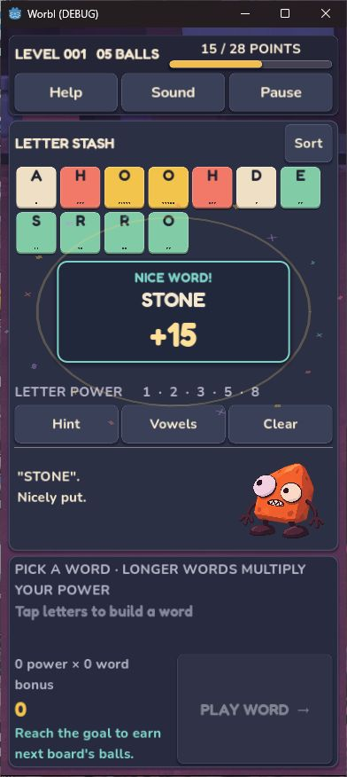

# Worbl

**Drop. Collect. Spell.**

A colorful Plinko-inspired word game: aim your marbles, collect letters with different power levels, and build words to clear each board.

## Play in Safari on your iPhone

**[Play Worbl in your browser](https://mmmmelted.github.io/Worbl/)** — no installation or TestFlight required. Tap **Open Worbl**, keep your phone upright, and send feedback about the controls, readability, difficulty, and sound.

The Safari preview is **0.2.3-web.8**, with sharper Retina rendering by default, a taller phone board and a thumb aiming strip: slide below the board, then release to drop. The full letter table appears when you build a word. Settings includes a Sharper display toggle for choosing lower graphics load. The approved soft letter sounds are unchanged. Physical iPhone comfort, clarity and temperature still need feedback. Windows/Android downloads remain v0.2.3.

This browser preview enables the full game for testing. It saves progress in the current browser; private browsing or clearing website data may erase that progress. The browser version does not test native purchases or all device features. Physical iPhone/Safari testing is still needed.

## Download the development preview

**[Download v0.2.3](https://github.com/mmmMelted/Worbl/releases/tag/v0.2.3)**

| Platform | Download | How to play |
| --- | --- | --- |
| Windows 64-bit | [Windows ZIP](https://github.com/mmmMelted/Worbl/releases/download/v0.2.3/Worbl-v0.2.3-Windows.zip) | Extract the ZIP. Open `Worbl.exe`, keeping `Worbl.pck` beside it. |
| Android | [Android APK](https://github.com/mmmMelted/Worbl/releases/download/v0.2.3/Worbl-v0.2.3-Android.apk) | Development APK for testing on Android 8 or newer; arm64 and x86_64. |
| iPhone Safari | [Browser playtest](https://mmmmelted.github.io/Worbl/) | Open in Safari and tap Open Worbl. A native iOS app is not available yet. |

This is an unfinished **development preview**, not the commercial release. Full content is enabled for testing. Android is debug-signed, and the latest version has not been validated on physical phones. There is no App Store or Google Play release yet.

## Inside the game

- A 120-stage campaign, daily challenges, and endless play.
- Five letter-power tiers, six upgrades, achievements, and collectible board finishes.
- A development leaderboard, local saves, and portrait controls.
- Mechanical peg clacks, musical letter pickups, flying reward tiles, and word-score celebrations.
- Separate music/effects volume controls and Reduced Motion.

The campaign starts with 10 balls. Each ball normally collects its first letter target plus a letter from its landing slot; the Spring upgrade allows an extra target pickup. Small pegs affect the bounce without awarding a letter. Word score combines letter power and length. Reach the board's goal within three words.

On a phone, slide along the aiming strip below the board and release to drop one ball; slide outside to cancel. Use **Drop 5** for a volley. Collect letters, choose **Build a word**, and tap your stash in word order. On desktop, arrows aim, Space drops, letter keys select tiles, and Enter submits.

## Actual game screenshots

These are phone-sized Windows captures of the game, paused during feedback animations; they are not iPhone screenshots.

 

## Feedback

[Report a bug or share playtest feedback](https://github.com/mmmMelted/Worbl/issues/new/choose). Include the build version, device/OS, what happened, and what you expected. Please leave passwords, keys, and other private information out of reports.

## Repository contents

This repository contains public information, screenshots, downloadable builds, and a compiled browser playtest under docs/. The game's source code is maintained separately in a private repository. GitHub's automatic **Source code** archives contain this public repository, including the compiled browser build, not the private development source.

The working title is Worbl. The planned mobile release is free to try with a one-time full-game unlock. Store purchases, device testing, balancing, and iOS distribution are still in development.

## Credits

Made with Godot. Godot, font, and dictionary license notices are included with the Windows download and in [the browser build](docs/licenses/); bundled third-party components retain their own licenses. This public page does not grant an open-source license to the game or its artwork.
